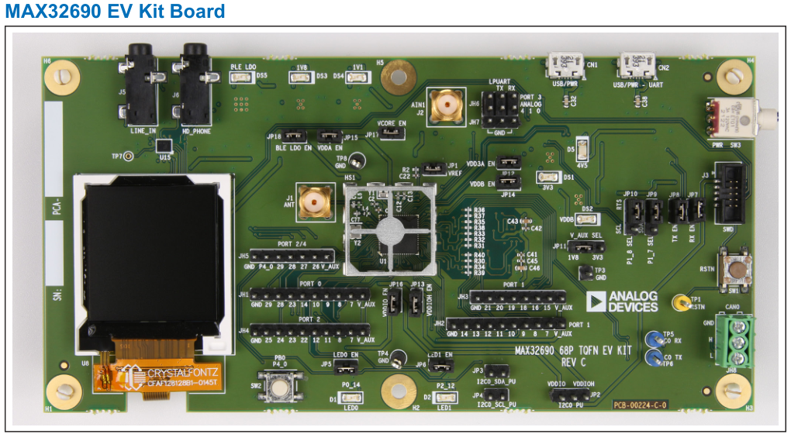
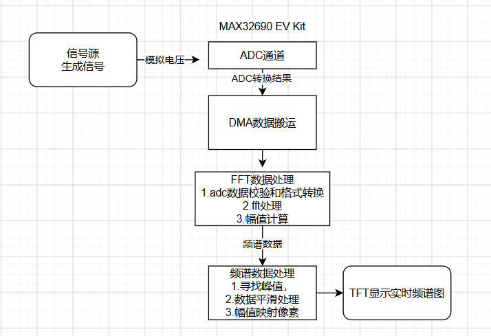
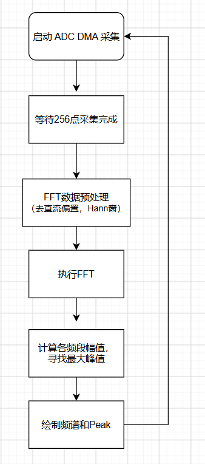
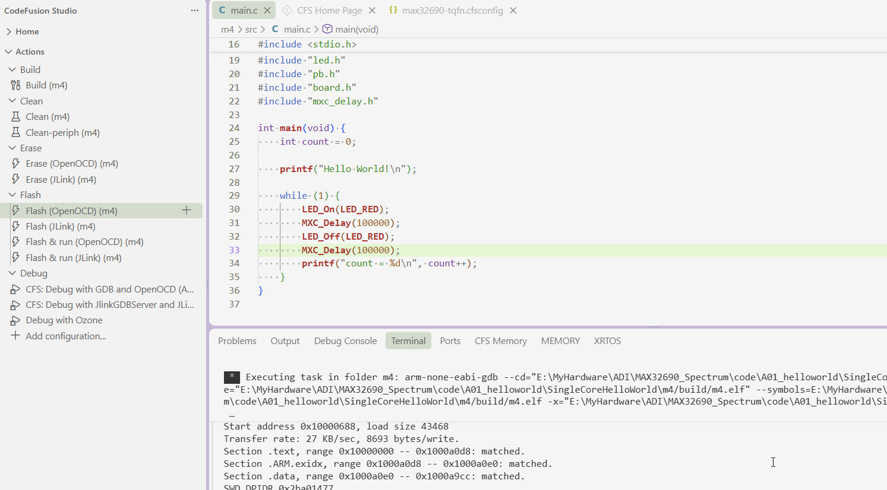
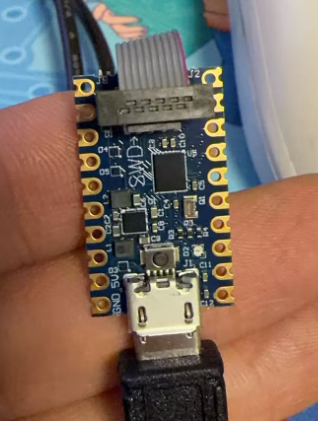
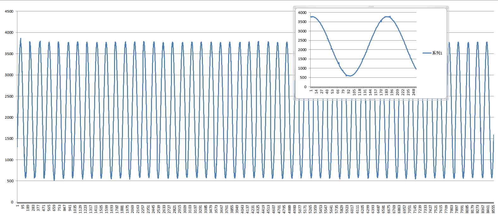
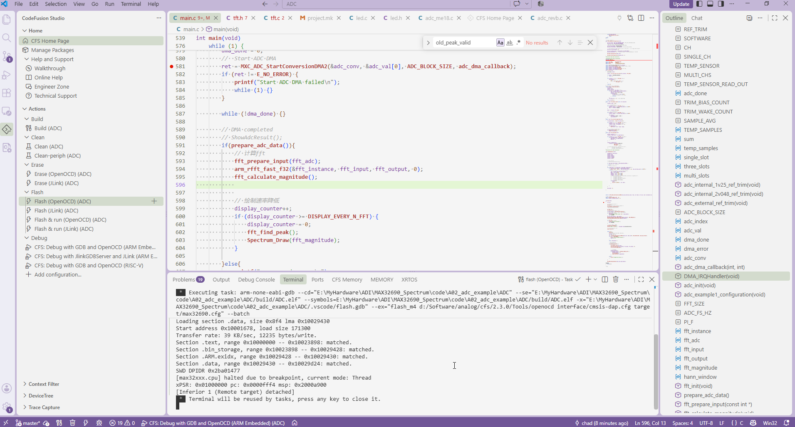
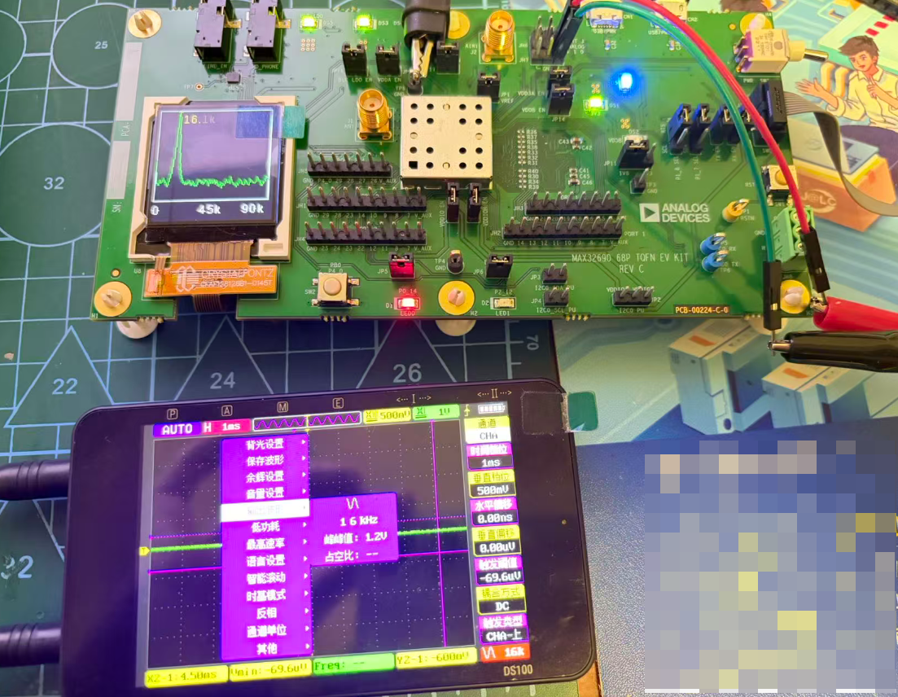
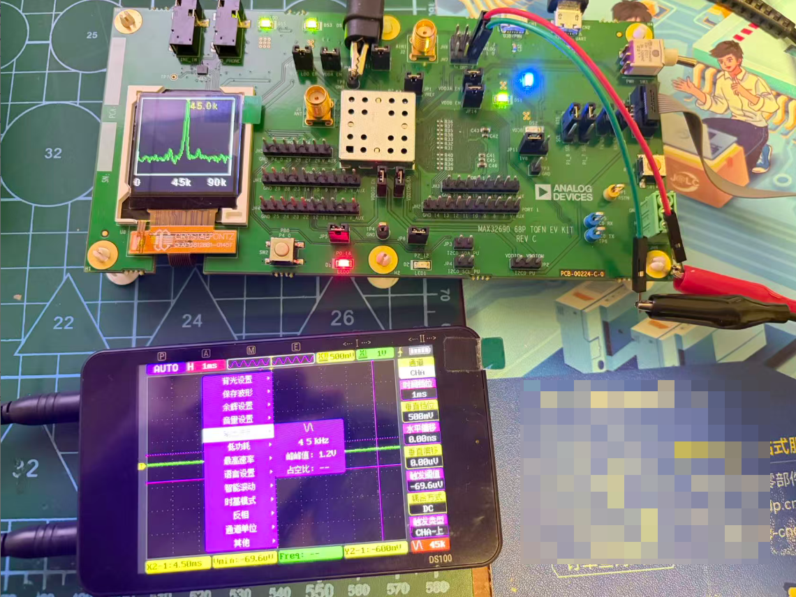
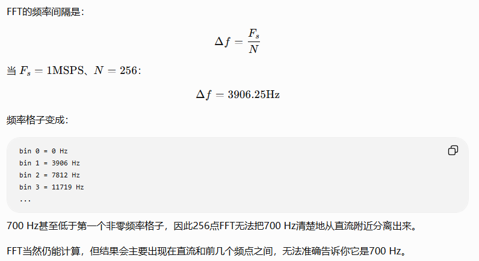

# 基于MAX32690的简易频谱仪


## 1. 简介

参加了一个由 ADI 赞助硬禾举办的 2026ADI CodeFusion Studio 活动。开发板选择的是 ADI 的 MAX32690EVKIT。


**1）所选任务**

打算自命题

​	任务题目：简易频谱仪

​	描述：做一个频谱仪，实现低频频率的识别。流程为：使用ADC 通过 DMA 进行高速数据采样，做FFT实现频谱计算，在 TFT LCD 进行实时频谱图的展示。

**2）硬件介绍**

资源汇总：

- [ADI-MAX32690](https://www.analog.com/en/products/max32690.html)

- [MAX32690EVKIT](https://www.analog.com/en/resources/evaluation-hardware-and-software/evaluation-boards-kits/max32690evkit.html)


**板卡介绍**

MAX32690EVKit板卡美照：




**MAX32690 芯片介绍**

MAX32690 有两个核心，主处理器是带 FPU 的 ARM-CM4，还有 RISC-V 协处理器。

主要参数

- Ultra-Efficient Microcontroller for Battery-Powered Applications
  - 120MHz Arm Cortex-M4 Processor with FPU
  - Ultra-Low-Power, 32-Bit RISC-V (RV32) Coprocessor Available to Offload Data Processing
  - Multiple Internal Low-Power Oscillators
  - 32.768kHz RTC Clock (Requires External Crystal)
  - 3.25MB Internal Flash, 1MB Internal SRAM
  - 85μW/MHz ACTIVE Mode at 1.1V
  - 1.8V and 3.3V I/O with No Level Translators
  - External Flash and SRAM Expansion Interfaces

3.25MB flash，1MB 内存，真不错。


题外话：ADI 帆布包很好看！


**系统框图**




软件流程：



最终的指标：

```
采样率 Fs        ≈ 180 kSPS
FFT点数 N         = 256
频点间隔 Δf       = Fs / N
                  ≈ 703.125 Hz

频谱范围          ≈ 0～90 kHz
有效显示bin       = 1～127
单帧采样时间      ≈ 256 / 180000
                  ≈ 1.42 ms
```


## 2. IDE使用

本次指定使用 CodeFusion Studio，需要在VSCODE上安装插件并安装SDK。安装步骤跳过。

编译后使用OpenOCD进行擦除和烧录：[OpenOCD是什么?J-Link、J-Trace、OpenJTAG的区别](https://www.eefocus.com/e/1816157.html)




调试器是一块基于MAX32650做的SWD调试器，小小的模块承载大大的梦想。



## 3. 频谱仪功能开发流程

### 3.1 通过DMA采集ADC

通过DMA采集ADC，输出稳定数据。


```

无输入 0x65d 左右

0~1.2V基本上是采样值可以从0x0~0xF90
但是我的直流稳压电源在低压时好像不太稳定
0V      0x000~0x021
0.1V    0x140~0x19b（甚至有0x0F5在前几秒)
使用信号源选择方波，占空比99%进行测试：

1.2 F0E 

1.1 DCC 

1.0 C8B 

0.9 B4E 

0.8 A0F 

0.7 8D5 

0.6 791 

0.5 658 

数据还是比较线性


```


测量测样率，通过led判断采样，开启DMA前开LED,在中断中关闭LED：

关闭输出，每次采集256点后， 间隔是1.92ms, 高电平1.42ms。


下图为1k数据下的连续采样和单包256个数据的图像：



- 采集占空比：1.42 / 1.92 ≈ 74%

- 块内实际采样率：`Fs=256 / 1.42 ms  = 180 kSPS`，ADC每秒产生约18万个采样点。根据内奎斯特定律，最高采样率为 Fs/2=90KHz

- 每个采样点间隔约：Ts=256/1.42 ms=5.55 μs

当前180kSPS采样率基本可用，后面可以提高速率，现在ADC时钟是16分频，可以减小分频。（但不能太快，ADC规定最多25MHz, 当前的时钟为120MHz，起码8分频才行）

```
     // 查看当前频率  120MHz
    SystemCoreClockUpdate();
    printf("HCLK = %lu Hz\n",  (unsigned long)SystemCoreClock);
```


当前256点FFT大致为：

$fmax=Fs/s=90 kHz$

$Δf=Fs/256 = 703 Hz/bin$


### 3.2 进行FFT进行频率判断

####  1）ARM CMSIS-DSP库引入

为了使用ARM FFT，需要重新引入CMSIS-DSP库。

MAX32690是Cortex-M4F，先用CMSIS-DSP的单精度浮点实数FFT：`arm_rfft_fast_f32()` ，这是为实数输入优化的FFT；官方说明支持32、64、128、256一直到4096点，并使用压缩格式存放实数FFT结果。[CMSIS-DSP Real FFT官方说明](https://arm-software.github.io/CMSIS-DSP/latest/group__RealFFT.html?utm_source=chatgpt.com)

先在工程里搜索：

```
arm_math.h
arm_rfft_fast_f32
```

如果能够找到，说明SDK中已经包含CMSIS-DSP；如果只找到头文件、链接时报未定义，再处理CMSIS-DSP库的编译链接。

看到example下有arm-dsp，其中有fft, 打开看看。其中，mk下有

```

# Include the CMSIS-DSP library
LIB_CMSIS_DSP = 1
```

增加到当前目录下，可以正确识别 arm_math.h 头文件，并编译成功。


#### 2）在MAX32690上实现FFT


**第一步：定义缓冲区**

```
#include <math.h>
#include "arm_math.h"

#define FFT_SIZE       256U
#define ADC_FS_HZ      182400.0f
#define PI_F           3.14159265358979323846f

static arm_rfft_fast_instance_f32 fft_instance;

static float32_t fft_input[FFT_SIZE];
static float32_t fft_output[FFT_SIZE];
static float32_t fft_magnitude[FFT_SIZE / 2 + 1];
static float32_t hann_window[FFT_SIZE];
```

这里需要三个不同的数组：

- `adc_val[]`：DMA写入的原始ADC数据；
- `fft_input[]`：去直流、加窗后的浮点数据；
- `fft_output[]`：FFT计算出的复数结果；
- `fft_magnitude[]`：最终各频率的幅度。

**第二步：初始化FFT和窗函数**

只在程序启动时执行一次：

```
int fft_init(void)
{
    arm_status status;

    status = arm_rfft_fast_init_f32(&fft_instance, FFT_SIZE);

    if (status != ARM_MATH_SUCCESS) {
        return -1;
    }

    for (uint32_t i = 0; i < FFT_SIZE; i++) {
        hann_window[i] =
            0.5f -
            0.5f * cosf((2.0f * PI_F * i) /
                        (FFT_SIZE - 1));
    }

    return 0;
}
```

在 `main()` 初始化阶段调用：

```
if (fft_init() != 0) {
    printf("FFT init failed\n");
    while (1) {}
}
```

**第三步：ADC数据预处理**

DMA完成后调用：

```
static void fft_prepare_input(const int *adc_data)
{
    float32_t mean = 0.0f;

    /* 1. 计算256点平均值 */
    for (uint32_t i = 0; i < FFT_SIZE; i++) {
        uint32_t sample = ((uint32_t)adc_data[i]) & 0x0FFF;
        mean += (float32_t)sample;
    }

    mean /= (float32_t)FFT_SIZE;

    /* 2. 去直流并乘Hann窗 */
    for (uint32_t i = 0; i < FFT_SIZE; i++) {
        uint32_t sample = ((uint32_t)adc_data[i]) & 0x0FFF;

        fft_input[i] =
            ((float32_t)sample - mean) *
            hann_window[i];
    }
}
```

如果你使用的是 `DATA_STATUS` 格式，还应该先检查 `INVALID` 位；无效数据不能送进FFT。如果确实是纯 `DATA` 格式，则取低12位即可。

**第四步：执行FFT**

```
arm_rfft_fast_f32(&fft_instance,
                  fft_input,
                  fft_output,
                  0);
```

最后一个参数：

```
0：正向FFT
1：逆FFT
```

我们需要的是正向FFT，所以填0。

**第五步：理解FFT输出格式**

对于256点实数FFT：

- `fft_output[0]`：0 Hz，也就是直流；
- `fft_output[1]`：奈奎斯特频率；
- `fft_output[2*k]`：第 kk 格的实部；
- `fft_output[2*k+1]`：第 kk 格的虚部。

第 k 格的幅度为：

$A[k]=\sqrt{\operatorname{Re}[k]^2+\operatorname{Im}[k]^2}$

代码：

```
static void fft_calculate_magnitude(void)
{
    fft_magnitude[0] = fabsf(fft_output[0]);

    for (uint32_t k = 1; k < FFT_SIZE / 2; k++) {
        float32_t real = fft_output[2 * k];
        float32_t imag = fft_output[2 * k + 1];

        fft_magnitude[k] =
            sqrtf(real * real + imag * imag);
    }

    /* Nyquist频点是特殊的纯实数 */
    fft_magnitude[FFT_SIZE / 2] =
        fabsf(fft_output[1]);
}
```

初期只是找频率峰值，不必急着做精确幅度归一化。

**第六步：寻找最大频率峰值**

不要把 `bin 0` 算进去，因为它是直流：

```
static void fft_find_peak(void)
{
    uint32_t peak_bin = 1;
    float32_t peak_value = fft_magnitude[1];

    for (uint32_t k = 2; k < FFT_SIZE / 2; k++) {
        if (fft_magnitude[k] > peak_value) {
            peak_value = fft_magnitude[k];
            peak_bin = k;
        }
    }

    uint32_t frequency_hz =
        (uint32_t)(((float32_t)peak_bin *
                    ADC_FS_HZ /
                    FFT_SIZE) + 0.5f);

    printf("peak bin=%lu, frequency=%lu Hz\n",
           (unsigned long)peak_bin,
           (unsigned long)frequency_hz);
}
```

整个调用过程为：

```
while (1) {
    /* 启动256点DMA */
    dma_done = 0;

    ADC_StartBlockDMA(...);

    while (!dma_done) {}

    if (dma_error == E_NO_ERROR) {
        fft_prepare_input(adc_val);

        arm_rfft_fast_f32(&fft_instance,
                          fft_input,
                          fft_output,
                          0);

        fft_calculate_magnitude();
        fft_find_peak();
    }
}
```

DMA必须已经完成，才能处理当前 `adc_val[]`，否则CPU读数组时DMA还在修改它。

**初次测试预期**

按现在约182.4 kSPS计算：

| 信号源频率 | 预计FFT表现                     |
| ---------- | ------------------------------- |
| 700 Hz     | 峰值主要在bin 1，也就是约712 Hz |
| 1 kHz      | 能量分散在bin 1、bin 2附近      |
| 2.85 kHz   | 峰值比较集中地出现在bin 4       |
| 5.7 kHz    | 峰值比较集中地出现在bin 8       |

因此，第一次先输入约2.85 kHz正弦波，检查是否得到：

```
peak bin=4, frequency=2850 Hz
```

然后再换回1 kHz观察泄漏。

注意当前256点FFT不能精确报告1 kHz。它可能只报告712 Hz或1425 Hz，因为频率格子宽达约712 Hz。这不是采样率不够，而是采样时间太短。

如果改为1024点：

$Δf=\frac{182400}{1024}\approx178.1\text{Hz}$

频率判断就会细很多。


**进行测试**

把上面的FFT计算和peak获取加上后，测试从1k~50k的信号频率均有显示。不过受限于频点间隔$\Delta f = 703Hz$，所以只能以这个倍数显示。


后面可进行

```
打印前20～30个bin的幅值，实际观察频谱结构；
用1 kHz方波观察1、3、5次谐波；
从256点升级到1024点；
最后再加入峰值插值，把频率估计提高到bin之间。
```


### 3.3 驱动屏幕进行最大频率的显示

首先跑TFT demo, 然后修改为频谱显示，完整代码如下：

注因为只用了256的前一半，所以要测试显示到中间下标应该是64。

```

/***** Includes *****/
#include <stdio.h>
#include <stdint.h>
#include <stdlib.h>
#include <string.h>
#include "icc.h"
#include "mxc_device.h"
#include "mxc_delay.h"
#include "led.h"
#include "pb.h"
#include "tft_st7735.h"

void TFT_Print(char *str, int len, int x, int y, int font)
{
    // fonts id
    text_t text;
    text.data = str;
    text.len = len;
    MXC_TFT_PrintFont(x, y, font, &text, NULL);
}

#include <math.h>
#include <stdint.h>
#include <string.h>
#include "tft_st7735.h"

#define FFT_SIZE       256
#define FFT_BINS       (FFT_SIZE / 2)

/* 绘图区，底部留出频率文字的位置 */
#define PLOT_X0        2
#define PLOT_X1        125
#define PLOT_Y0        3
#define PLOT_Y1        108

#define PLOT_WIDTH     (PLOT_X1 - PLOT_X0 + 1)
#define PLOT_HEIGHT    (PLOT_Y1 - PLOT_Y0 + 1)

/* RGB565颜色 */
#define COLOR_BG       0x0000
#define COLOR_AXIS     0xFFFF
#define COLOR_TRACE    0x07E0

/*
 * 第一版先使用相对dB。
 * 后续完成ADC幅度标定后，再改成真正的dBFS。
 */
#define DB_MAX         0.0f
#define DB_MIN        (-80.0f)

static int16_t old_y[PLOT_WIDTH];
static float smooth_db[FFT_BINS];
static uint8_t first_frame = 1;

static float clamp_float(float value, float min, float max)
{
    if (value < min) {
        return min;
    }

    if (value > max) {
        return max;
    }

    return value;
}

static int spectrum_db_to_y(float db)
{
    float ratio;

    db = clamp_float(db, DB_MIN, DB_MAX);

    ratio = (db - DB_MIN) / (DB_MAX - DB_MIN);

    /*
     * 屏幕坐标向下增大：
     * DB_MAX映射到顶部，DB_MIN映射到底部。
     * 留一个像素，防止曲线擦掉边框。
     */
    return (PLOT_Y1 - 1) -
           (int)(ratio * (float)(PLOT_HEIGHT - 3));
}

void Spectrum_Init(void)
{
    int i;
    char buff[] = "test";
    // MXC_TFT_SetBackGroundColor(COLOR_BG);
    MXC_TFT_SetBackGroundColor(COLOR_BG); // Clear screen
    MXC_TFT_SetForeGroundColor(WHITE); // set chars to white
    MXC_TFT_ClearScreen();

    /* 频谱区域边框 */
    MXC_TFT_Rectangle(PLOT_X0,
                      PLOT_Y0,
                      PLOT_X1,
                      PLOT_Y1,
                      COLOR_AXIS);

    /*
     * Fs = 180kHz，所以横轴范围为0～90kHz。
     * 如果文字太挤，可以暂时不显示。
     */
    
    TFT_Print("0", 1, 2, 113, (int)&Liberation_Sans12x12[0]);
    TFT_Print("45k", 3, 52, 113, (int)&Liberation_Sans12x12[0]);
    TFT_Print("90k", 3, 98, 113, (int)&Liberation_Sans12x12[0]);

    for (i = 0; i < PLOT_WIDTH; i++) {
        old_y[i] = PLOT_Y1 - 1;
    }

    for (i = 0; i < FFT_BINS; i++) {
        smooth_db[i] = DB_MIN;
    }

    first_frame = 1;
}

void Spectrum_Draw(const float *fft_mag)
{
    int x;
    int k;
    int k_start;
    int k_end;
    uint16_t new_y[PLOT_WIDTH];

    float max_mag;
    float db;
    float pixel_db;

    /*
     * 找到这一帧的最大幅值。
     *
     * 忽略bin 0，因为它主要是ADC直流偏置。
     * 第一版用相对最大值显示，因此最强信号显示为0dB。
     */
    max_mag = 0.000001f;

    for (k = 1; k < FFT_BINS; k++) {
        if (fft_mag[k] > max_mag) {
            max_mag = fft_mag[k];
        }
    }

    /*
     * 转换为相对dB并进行平滑。
     * 0.75代表保留上一帧，0.25代表加入当前帧。
     */
    for (k = 1; k < FFT_BINS; k++) {
        db = 20.0f * log10f((fft_mag[k] + 0.000001f) / max_mag);

        db = clamp_float(db, DB_MIN, DB_MAX);

        smooth_db[k] =
            0.75f * smooth_db[k] +
            0.25f * db;
    }

    /*
     * 把127个有效bin映射到屏幕横向像素。
     *
     * bin 0不显示。
     * 如果多个bin落到同一个像素，取其中最大的值，
     * 这样窄带尖峰不会被平均掉。
     */
    for (x = 0; x < PLOT_WIDTH; x++) {
        k_start = 1 +
                  x * (FFT_BINS - 1) / PLOT_WIDTH;

        k_end = 1 +
                (x + 1) * (FFT_BINS - 1) / PLOT_WIDTH;

        if (k_end <= k_start) {
            k_end = k_start + 1;
        }

        if (k_end > FFT_BINS) {
            k_end = FFT_BINS;
        }

        pixel_db = DB_MIN;

        for (k = k_start; k < k_end; k++) {
            if (smooth_db[k] > pixel_db) {
                pixel_db = smooth_db[k];
            }
        }

        new_y[x] = spectrum_db_to_y(pixel_db);
    }

    /*
     * 先用背景色擦除上一条曲线。
     * 第一帧没有旧曲线，不需要擦除。
     */
    //if (!first_frame) {
        for (x = 0; x < PLOT_WIDTH - 1; x++) {
            MXC_TFT_Line(PLOT_X0 + x,
                         old_y[x],
                         PLOT_X0 + x + 1,
                         old_y[x + 1],
                         COLOR_BG);
        }
    //}

    /* 绘制当前频谱 */
    for (x = 0; x < PLOT_WIDTH - 1; x++) {
        MXC_TFT_Line(PLOT_X0 + x,
                     new_y[x],
                     PLOT_X0 + x + 1,
                     new_y[x + 1],
                     COLOR_TRACE);
    }

    /*
     * 擦除曲线时可能碰到边框，所以重新画边框。
     */
    MXC_TFT_Rectangle(PLOT_X0,
                      PLOT_Y0,
                      PLOT_X1,
                      PLOT_Y1,
                      COLOR_AXIS);

    memcpy(old_y, new_y, sizeof(old_y));
    first_frame = 0;
}

int main(void)
{
    MXC_Delay(MXC_DELAY_SEC(2));

    /* Enable cache */
    MXC_ICC_Enable(MXC_ICC0);

    /* Set system clock to 100 MHz */
    MXC_SYS_Clock_Select(MXC_SYS_CLOCK_IPO);
    SystemCoreClockUpdate();

    /* Initialize TFT display */
    MXC_TFT_Init();
    // TFT_test();
   Spectrum_Init();
    float fft_mag[256] = {0};
    fft_mag[14] = 10000.0f;
    fft_mag[64] = 45000.0f;
    while(1){
        
        Spectrum_Draw(fft_mag);
        MXC_Delay(10000);
    }
    return 0;
}

```


最终版本加上了peak，核心绘制函数为：

```
void Spectrum_Draw(const float *fft_mag)
{
    int x;
    int k;
    int k_start;
    int k_end;
    uint16_t new_y[PLOT_WIDTH];

    float max_mag;
    float db;
    float pixel_db;
    int max_bin;

    /*
     * 找到这一帧的最大幅值。
     *
     * 忽略bin 0，因为它主要是ADC直流偏置。
     * 第一版用相对最大值显示，因此最强信号显示为0dB。
     */
    max_mag = 0.000001f;

    for (k = 1; k < FFT_BINS; k++) {
        if (fft_mag[k] > max_mag) {
            max_mag = fft_mag[k];
        }
    }

    /*
     * 转换为相对dB并进行平滑。
     * 0.75代表保留上一帧，0.25代表加入当前帧。
     */
    for (k = 1; k < FFT_BINS; k++) {
        db = 20.0f * log10f((fft_mag[k] + 0.000001f) / max_mag);

        db = clamp_float(db, DB_MIN, DB_MAX);

        smooth_db[k] =
            0.75f * smooth_db[k] +
            0.25f * db;
    }
    max_bin = Spectrum_FindMaxBin();

    /*
     * 把127个有效bin映射到屏幕横向像素。
     *
     * bin 0不显示。
     * 如果多个bin落到同一个像素，取其中最大的值，
     * 这样窄带尖峰不会被平均掉。
     */
    for (x = 0; x < PLOT_WIDTH; x++) {
        k_start = 1 +
                  x * (FFT_BINS - 1) / PLOT_WIDTH;

        k_end = 1 +
                (x + 1) * (FFT_BINS - 1) / PLOT_WIDTH;

        if (k_end <= k_start) {
            k_end = k_start + 1;
        }

        if (k_end > FFT_BINS) {
            k_end = FFT_BINS;
        }

        pixel_db = DB_MIN;

        for (k = k_start; k < k_end; k++) {
            if (smooth_db[k] > pixel_db) {
                pixel_db = smooth_db[k];
            }
        }

        new_y[x] = spectrum_db_to_y(pixel_db);
    }

    /* 1. 擦除旧的Peak文字和标记 */
    Spectrum_ClearMaxPeak();
    /*
     * 2. 擦除旧频谱曲线
     * 先用背景色擦除上一条曲线。
     * 第一帧没有旧曲线，不需要擦除。
     */
    if (!first_frame) {
        for (x = 0; x < PLOT_WIDTH - 1; x++) {
            MXC_TFT_Line(PLOT_X0 + x,
                         old_y[x],
                         PLOT_X0 + x + 1,
                         old_y[x + 1],
                         COLOR_BG);
        }
    }

    /* 3. 绘制当前频谱 */
    for (x = 0; x < PLOT_WIDTH - 1; x++) {
        MXC_TFT_Line(PLOT_X0 + x,
                     new_y[x],
                     PLOT_X0 + x + 1,
                     new_y[x + 1],
                     COLOR_TRACE);
    }

    /* 4. 最后标记最大峰，并显示频率 */
    Spectrum_DrawMaxPeak(max_bin);

    /*
     * 擦除曲线时可能碰到边框，所以重新画边框。
     */
    MXC_TFT_Rectangle(PLOT_X0,
                      PLOT_Y0,
                      PLOT_X1,
                      PLOT_Y1,
                      COLOR_AXIS);

    memcpy(old_y, new_y, sizeof(old_y));
    first_frame = 0;
}

```


## 4. 频谱仪功能测试与演示

Code Fusion 软件使用截图：




功能演示截图：

信号源16kHz



45kHz



## 5. 总结

通过本次实验，学会了Code Fusion的使用，作为VsCode插件来说，好用又快速。使用了ADI SDK进行开发，示例完整，添加ARM-DSP很方便。对FFT和频谱仪也多了一些了解。在自己的里程碑上也算是做了个简易频谱仪。

唯二不足的是这次没有尝试多核通信以及没有使用Zypher RTOS。


## 6. 关于FFT

### 带宽和分频率的关系

在采样率为180kSPS时，看正弦信号，1Mhz有1.5个周期，看700Hz信号差不多一个周期（符合`△F=Fs/N=180e3/256 = 703`)

如果速率提高了，比如还是700Hz，发现一包里只能看到一小段直线，这很反直觉啊，一次FFT才能看到一条直线，不是更不明白真实波形了吗，但是速率提高肯定是能识别更高的。


**高采样率的真正意义**

高采样率解决的是“能看多高的频率”，不是“能看多久”。

| 采样率   | 256点观察时间 | 理论最高频率 | FFT频率间隔 |
| -------- | ------------- | ------------ | ----------- |
| 180 kSPS | 1.422 ms      | 90 kHz       | 703 Hz      |
| 1 MSPS   | 0.256 ms      | 500 kHz      | 3906 Hz     |

可以看出，当FFT长度固定为256时：

- 采样率提高：最高分析频率提高；
- 观察时间缩短；
- 低频分辨率反而变差。

这就是带宽和频率分辨率之间的取舍。


**256点、1 MSPS无法很好识别700 Hz**

 

**提高采样率后，必须同步增加FFT点数**

要在1 MSPS下至少观察700 Hz的一个完整周期，需要：

$N≥1,000,000700≈1429N\geq\frac{1,000,000}{700}\approx1429$ 

 


FFT一般使用2的整数次幂，因此至少选：

```
FFT_SIZE = 2048;
```


**奈奎斯特定律没有解决低频分辨率**

奈奎斯特定律只说：

$f{signal}<\frac{F_s}{2}$ 

它保证信号不发生频率混叠，但不保证你在很短的数据中能准确测出频率。

例如1 MSPS采样700 Hz：

- 每周期约1429个采样点，采样密度非常高；
- 但你只保存256个点；
- 所以仅观察到不到五分之一周期；
- 无法准确判断完整周期究竟多长。

这就像每毫米拍一张高清照片，却只沿着一条很长的曲线拍了很短一段。照片很密，但观察范围太小。


**最终频谱仪通常怎么解决**

有三种方法：

**1) 方法一：增加FFT点数**

最直接：

```
高采样率 + 大FFT
```

优点是带宽和频率分辨率都保留，缺点是RAM占用和计算量增加。

**2) 方法二：根据目标频段切换采样率**

例如：

| 目标频段   | 采样率示例 | 1024点FFT分辨率 |
| ---------- | ---------- | --------------- |
| 0～10 kHz  | 25 kSPS    | 24.4 Hz         |
| 0～100 kHz | 250 kSPS   | 244 Hz          |
| 0～500 kHz | 1 MSPS     | 977 Hz          |

观察低频时没有必要一直使用1 MSPS。

**3) 方法三：高速采样后抽取**

这是SDR里非常重要的方法：

```
1 MSPS采样
    ↓
数字低通滤波
    ↓
每10点取1点
    ↓
得到100 kSPS
    ↓
做FFT
```

这样既可以让ADC保持高速运行，又能针对低频获得更长的观察时间和更细的频率分辨率。

但注意：不能直接每10点扔掉9点，抽取之前必须先低通滤波，否则高频会混叠到低频。


### 从零理解FFT

ADC拿到的是“电压随时间的变化”：

```
ADC采样：

时间  0      5.5us   11us    16.5us ...
数据  2100   2180    2250    2310   ...
```

这叫时域数据。你看到的正弦波就是时域波形。

FFT做的事情，是把这些点转换成：

```
频率       0Hz   712Hz  1425Hz  2137Hz ...
幅度        ?      ?       ?       ?
```

也就是告诉你：这一帧数据里，各种频率分别有多强。

FFT整体流程是：

```
ADC采集256点
    ↓
去掉直流分量（减去平均值）
    ↓
乘窗函数（先用Hann窗）
    ↓
执行256点FFT
    ↓
计算每个频率点的幅度
    ↓
寻找最大峰值或画频谱
```

#### FFT为什么会有一个个“频率格子”

256点FFT不能分辨任意精细的频率，而是把频率轴分成若干格。

每格宽度为：

$\Delta f=\frac{F_s}{N}$

按 `Fs=180kSPS 、N=256​`  计算：

$Δf=\frac{180e3}{256}=703\text{Hz}$

因此FFT的频率格子是：

| FFT序号 kk | 对应频率   |
| ---------- | ---------- |
| 0          | 0 Hz，直流 |
| 1          | 703 Hz     |
| 2          | 1406 Hz    |
| 3          | 2109 Hz    |
| 4          | 2812 Hz    |
| 5          | 3515 Hz    |
| …          | …          |
| 128        | 90 kHz     |

对应公式：

$f_k=k\frac{F_s}{N}$

所以你输入1 kHz时，它并不正好落在FFT格子上，而是位于：

```
703Hz ← 1000Hz → 1406Hz
  bin 1              bin 2
```

能量会分散到相邻几个格子，这叫频谱泄漏，不代表FFT写错了。

如果输入约2812 Hz，它正好落在第4格，频谱会看起来漂亮很多。因此第一次验证FFT时，建议用大约：2812 Hz，而不是1 kHz。

#### 为什么要减去平均值

你的ADC是单电源输入，例如正弦波可能在0.6 V附近上下变化：

```
ADC原始值 = 直流偏置 + 正弦信号
```

FFT后，直流偏置会在 `bin 0` 产生一个非常大的峰值，可能把真正的信号频谱淹没。

因此先计算平均值：

```
mean = 所有256点之和 / 256;
```

然后：

```
fft_input[i] = adc[i] - mean;
```

这样波形就从围绕ADC中间值摆动，变成围绕0摆动。

#### 为什么要加窗

FFT会假设这256点在前后无限重复。

如果这一帧不是完整整数周期，首尾连接时会突然跳变：

```
一帧结尾 ┐
         │ 突然跳变
下一帧开头┘
```

这个跳变会制造很多假的频率成分。

Hann窗会让一帧的两端逐渐减小到接近0，从而降低这个首尾跳变：

$w[n]=0.5-0.5\cos\left(\frac{2\pi n}{N-1}\right)$ 

处理方式是：

```
fft_input[i] = (adc[i] - mean) * hann_window[i];
```

代价是主峰会变宽一些，但通常比不加窗更适合频谱显示。